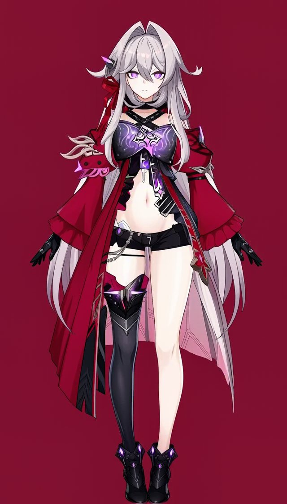
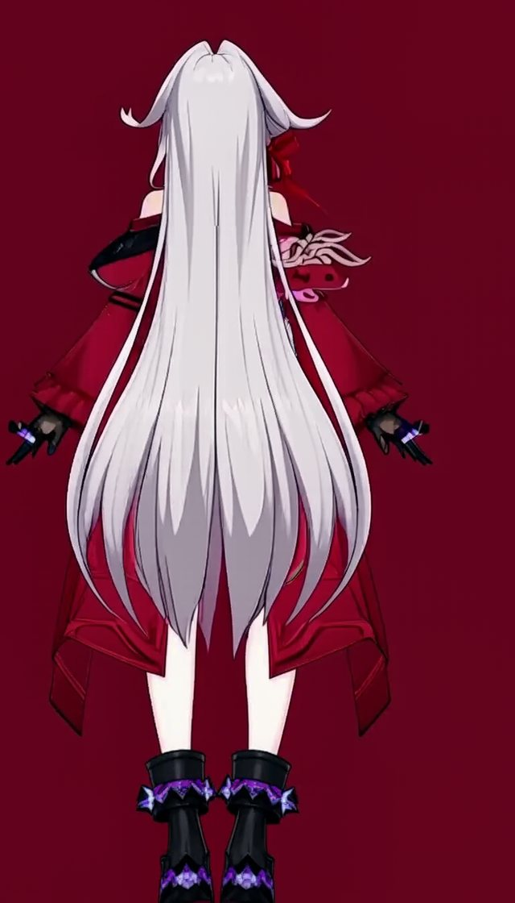
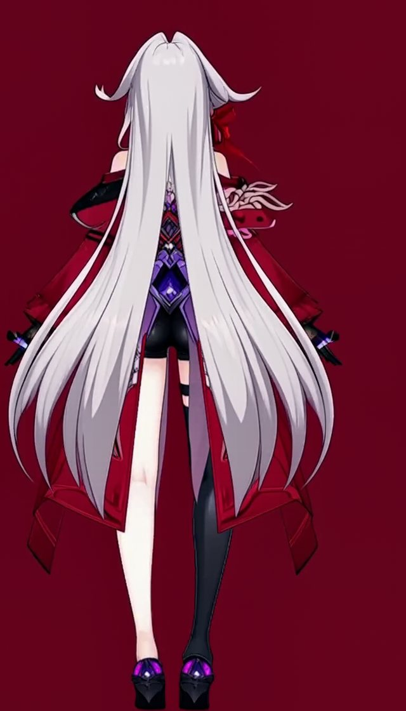
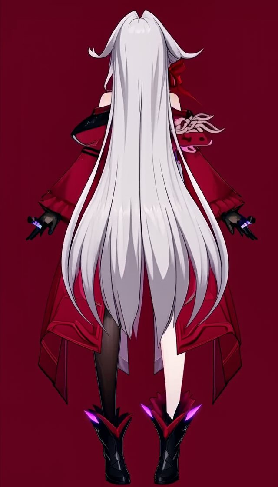
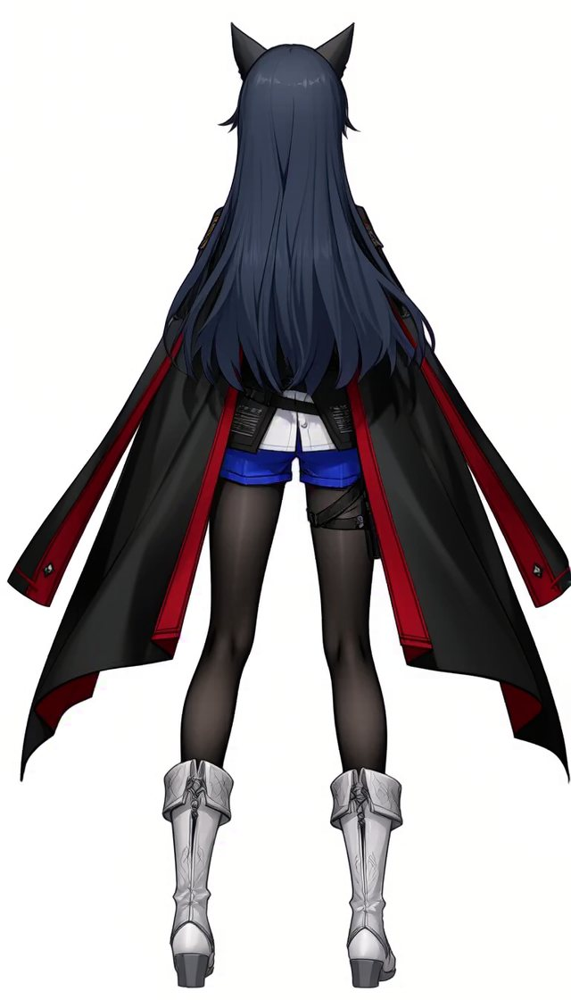

# 三视图里「朝向」和「部件」为什么老出错（MiniMax H3 实测）

> 证据等级：本文每条结论都对应下面「证据表」里一次真实渲染（同一台机器、同一套渲染锚：MiniMax H3 int8 fl2va，768×1344，30 步，采样器 res_multistep）。表里写了 seed 和参考图，可以照着复现；标「推断」的才是没单独验证的。

## 一、这一页解决什么问题

你要画角色的**正面 + 背面**，结果出了两种典型事故：

- 写了「这是背面 / 看不到脸」，出来的还是正脸；
- 背面朝向对了，但**腿上的靴子跟正面不一样**（正面及膝长靴，背面变成短靴或裸腿）。

这两件事都不是「词写得不够狠」，是参考图在管这件事。这一页给你三句话的结论、四条易错点、和一套能稳定出图的做法。

## 二、三句话结论

1. **朝向主要由参考图决定，但「措辞的形状」能翻盘——前提是句首就提机位、而且全篇一个字都不描述脸。**
   早期三组（20261903 / 20261904 / 20261905）把 `her back to the lens` 塞在段尾、其余照写脸和服装，连换三个 seed 全是正面；
   改成**句首**就写 `The camera stands behind her: we see the back of her head and the back of her cape`、并且整段不写五官，
   用同一张正面 2D 角色卡当参考图，3/3 个 seed（20264001 / 20264002 / 20264003）都出对了背身。
   所以本文此前那句「只能换参考图」说得太绝，已按实测改口。另一条仍然成立：换成紧裁切的背面参考图，一次就出对（20261910）。
2. **部件细节也从参考图继承，措辞压不住。** 背面参考图里是短靴，出来就是短靴——哪怕提示词写着「及膝长靴」。
3. **解法是「一张图管朝向，一张图管部件」：节点同时喂两张参考图。** `image_0` = 朝向/发型/大衣，`image_1` = 部件特写（本例是靴子），提示词里分别写成 `<Picture 1>` 和 `<Picture 2>`。

## 三、证据表

| # | 想要 | 参考图 | 提示词做法 | seed | 结果 | 对照图 |
|---|---|---|---|---|---|---|
| 1 | 背面全身 | 正面角色卡 | 版式里写 `her back to the lens` | 20261903 | 出了**正面** | — |
| 2 | 背面全身 | 正面角色卡 | 加一段 `her face does not appear in this picture at all - no eyes, no nose, no mouth` | 20261904 | 仍是**正面** | — |
| 3 | 背面全身 | 正面角色卡 | 把「the camera stands BEHIND her」提到提示词**最前面** | 20261905 | 仍是**正面** | `failure-08` |
| 4 | 背面全身 | **从已有三列表里裁的背面块**（紧裁切、纯色背景） | 同上，开头写 `keep exactly this orientation` | 20261910 | **出对背身** | `success-08` |
| 5 | 背面全身 | 官方卡里的背面大图（带背景、群像、动态姿势） | `keep the orientation of <Picture 1> exactly` | 20262002 | 又变**正面** | — |
| 6 | 背面 + 及膝长靴 | 背面块（腿上是短靴） | 文字写 `boots reaching just below the knee` | 20262003 | 朝向对，**靴子仍短** | `failure-09` |
| 7 | 背面 + 及膝长靴 | `image_0` 背面块 + `image_1` 靴子特写 | 分两段写 `<Picture 1>`＝朝向、`<Picture 2>`＝footwear | 20262041 | 朝向对 + **及膝长靴对** | `success-09` |
| 11 | 背面全身 | 正面 2D 角色卡 | 句首 `The camera stands behind her…`，**全篇不写脸**（A 组，无排除项） | 20264001 | **出对背身** | `success-11` |
| 12 | 同上 | 同一张 | 同 A + MJ 那串视角排除 `no front view, no face, no eyes, no side view, no three-quarter view`（B 组） | 20264001 | 也出对，**与 A 看不出差别** | — |
| 13 | 同上（重复验证） | 同一张 | A 组原样，只换 seed | 20264002 / 20264003 | 两次都出对 | — |

补充对照（跨列一致性，另一次实验）：

| # | 想要 | 写法 | seed | 结果 |
|---|---|---|---|---|
| 8 | 三列里背面那列头发到腰 | 把「背面头发到腰」写进**服装段** | 20261511 | 更差：大衣被拆成飘在肩上的碎片 |
| 9 | 同上 | 同一句挪进**版式锚点**（按画面位置写） | 20261521 | 命中，背面长发到腰 |
| 10 | 同上（严格对照） | 同句、同 seed 20261502 重跑 | 20261522 | 又变齐肩 → **不稳，第 9 条是掷中** |

结论：**跨列一致性靠措辞不可靠**，稳定做法见第五节（拆成单图再拼版）。第 5 条还说明：不是「任意一张背面图」都行，**带大背景和群像的插画会把构图一起带偏**（这一条只跑过一次，属单次观察，不是统计结论）。

## 四、后视图的四个易错点

1. **拿正面图当背面参考**——最高频。参考图里能看到五官时，默认它会把正面带出来；要救回来只有一种写法：句首提机位 + 全篇不写脸（证据表 11–13 三连对）。
2. **参考图里有背景/群像**——会连构图一起搬过来（证据表第 5 条）。参考图要裁到只剩角色本体。
3. **部件跟着错**（靴子、手甲、披风下摆）——参考图没画清的部件，模型会自己补一个「差不多」的，和正面列对不上。用第二张特写参考图。
4. **把设定当错误去修**——本例里「只有一条腿是长筒袜」是官方设定（官方卡里就是单腿），不要当成缺陷「修正」成两腿一样。

## 五、稳定做法：每列单独出图，最后拼版

一张横图里同时画三列，跨列一致性（头发长度、裙长、靴高）几乎一定是掷骰子。稳定流程是：

1. **每列各出一张** 768×1344 的单人图（同一套提示词，只改景别/机位段）；
2. 正面列：用正面参考图；背面列：用**背面参考图 + 部件特写**双图；
3. 佐证一致性的那一列（通常是头部特写）**不单独出图，直接从正面图里裁**——同一张图裁出来的一定是同一个角色；
4. 用 PIL 横拼成 **2304×1344**（每列 768×1344，原尺寸直接拼，不降采样）：全身图按高度缩放到 1344；特写列从正面图裁头肩后放大到 768×1344。
   **不要拼回 1344×768**——那样每列只剩 448 px、头约 110 px、眼睛约 10 px，放大就是一团暗影（见 `../examples/failure-10-eyes-lost-at-448px.jpg`；算式与做法在 `framing-lock.md` 的「三视图/角色表：脸被压到多少像素」）。

```python
from PIL import Image, ImageFilter
W, H = 768, 1344
front, back = Image.open("front.png").convert("RGB"), Image.open("back.png").convert("RGB")
bg = front.getpixel((8, 8))                      # 背景色从渲染图角落取，补齐缝看不出接痕

def fit(im):                                      # 全身图：按高度缩放后居中
    r = im.resize((round(im.width * H / im.height), H), Image.LANCZOS)
    c = Image.new("RGB", (W, H), bg); c.paste(r, ((W - r.width) // 2, 0)); return c

c = front.crop((222, 44, 546, 594))               # 头部特写：从正面图裁
tgt = W / H
if c.width / c.height > tgt:                      # 统一到 448:768
    nw = round(c.height * tgt); x = (c.width - nw) // 2; c = c.crop((x, 0, x + nw, c.height))
else:
    nh = round(c.width / tgt); c = c.crop((0, 0, c.width, nh))
p1 = c.resize((W, H), Image.LANCZOS).filter(ImageFilter.UnsharpMask(radius=1.5, percent=60, threshold=2))

sheet = Image.new("RGB", (W * 3, H), bg)
for i, p in enumerate((p1, fit(front), fit(back))):
    sheet.paste(p, (i * W, 0))
sheet.save("turnaround.png", "PNG")
```

## 六、双参考图怎么写进工作流

API 格式里，两张图分别占 `images.image_0` 与 `images.image_1`（两个都指向各自的 `LoadImage` 节点），提示词里写清谁管什么：

```
<Picture 1> is the back of this girl: keep that orientation exactly - the camera stands behind her, ...
<Picture 2> gives her footwear exactly, and both legs wear it identically: black leather boots reaching
to just below the knee, a flared V-shaped collar of violet crystal with a crimson lining at the top rim, ...
```

要点：**每张参考图都要有自己那一段「它管什么」**，并且在那一段里显式排除它不该带的（`keep the coat and palette of <Picture 1>`, `not ankle boots, not bare legs`）。

## 七、自检清单（出图前 5 秒）

- [ ] 背面列的参考图里**看不到五官**吗？
- [ ] 参考图是**紧裁切、纯色/干净背景**吗？
- [ ] 靴子/手甲这类跨列必须一致的部件，有没有**第二张特写参考图**？
- [ ] 提示词里有没有写「哪张图管什么」？
- [ ] 有没有把官方设定（单腿长筒袜、不对称护甲）当成 bug 去修？

## 八、对照图出处

四张都是本项目自己渲染的图（非他人作品、不含个人信息），按 640 宽、JPEG q84 压缩后入库。

**失败：措辞写到极致，仍是正面**（证据表第 3 条，seed 20261905）



**失败：朝向对了，靴子被参考图带成短靴**（证据表第 6 条，seed 20262003）



**成功：换成紧裁切的背面参考图，一次出对**（证据表第 4 条，seed 20261910）



**成功：双参考图，朝向与及膝长靴同时正确**（证据表第 7 条，seed 20262041）



**成功：不换参考图，只把提示词改成「句首提机位 + 不写脸」，同一张正面卡也能出背面**（证据表第 11 / 13 条，seed 20264001 / 20264002）


