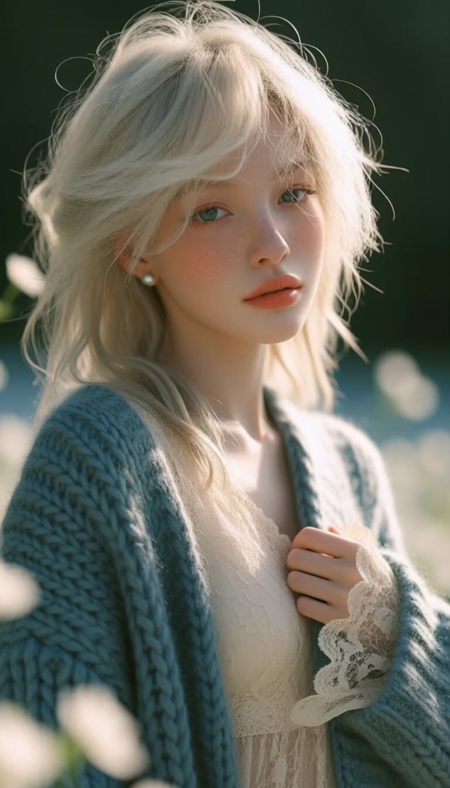
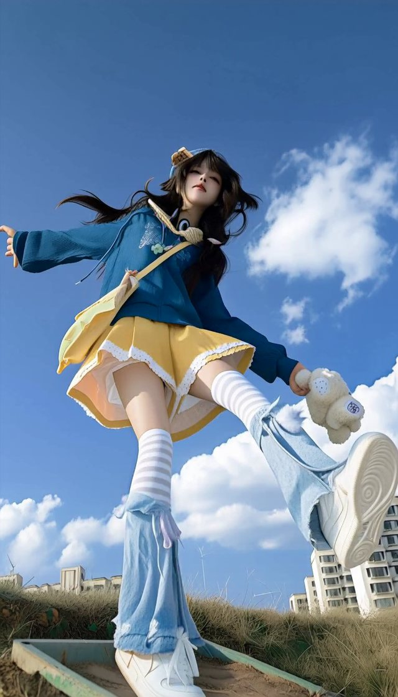
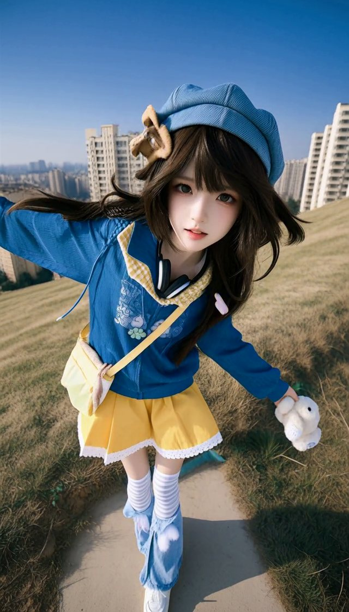
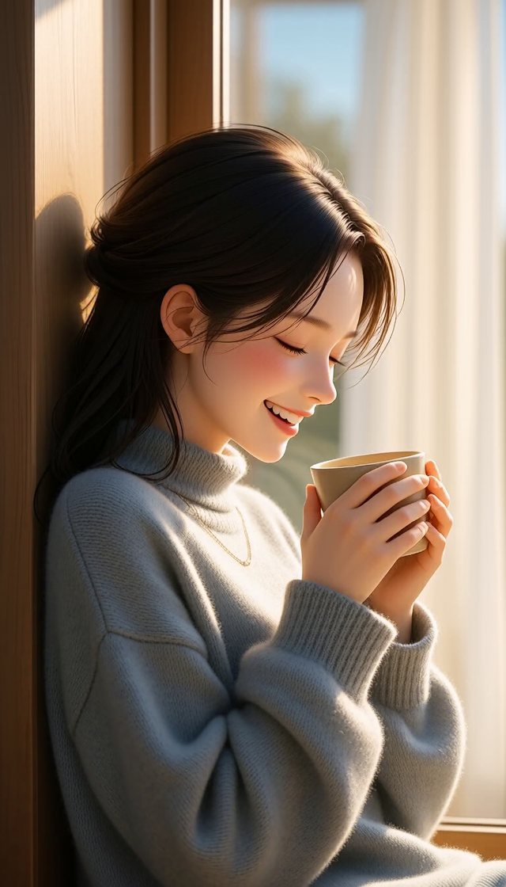
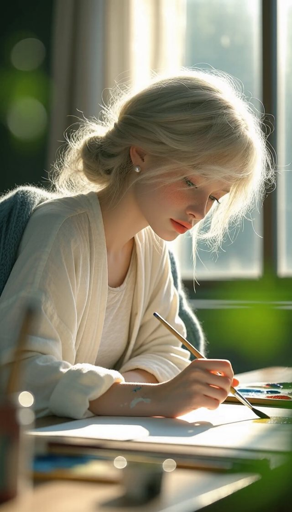
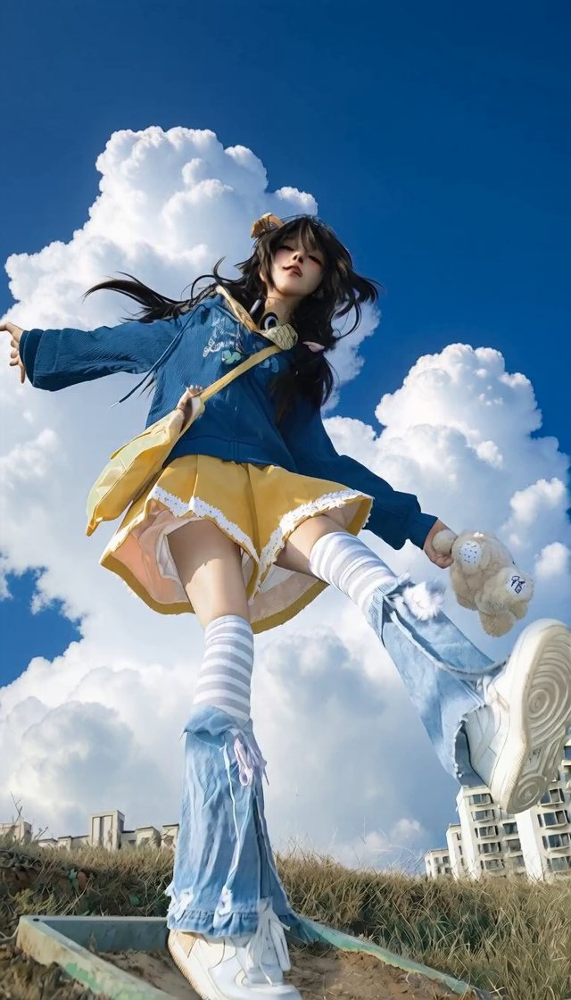
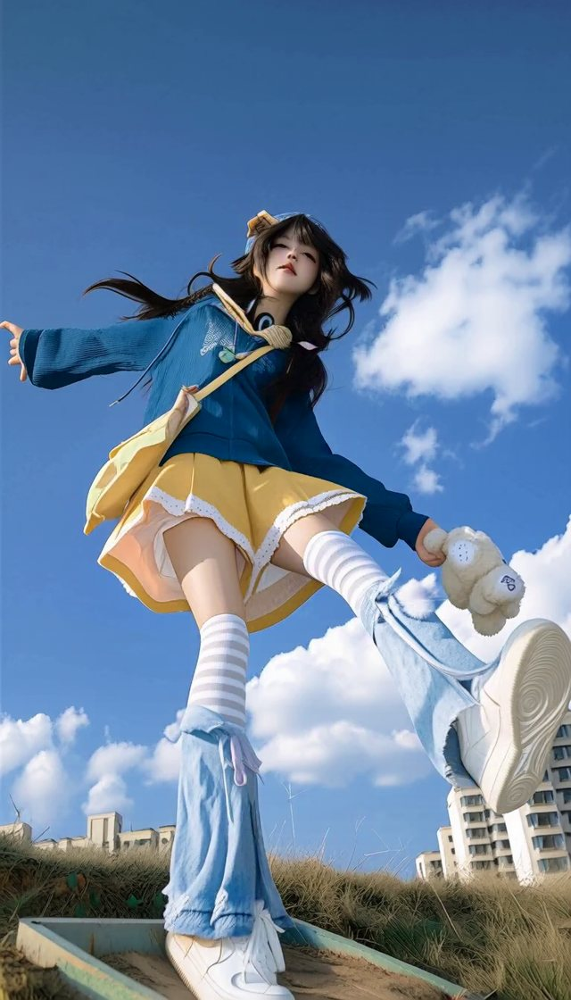
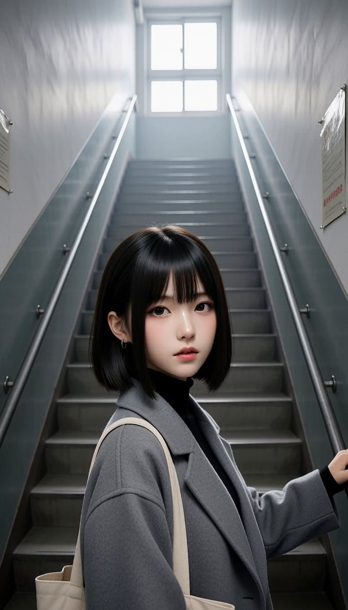
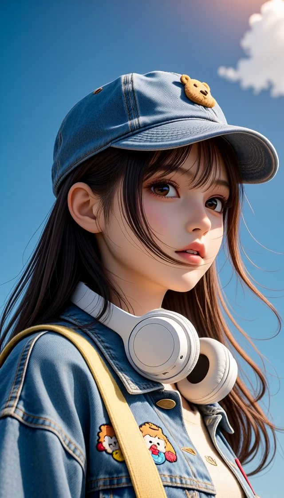

# 成功 / 失败案例（实拍，可对照）

每一张都是本机实跑出来的，参数统一：MiniMax H3 int8 fl2va、30 步、768×1344、RTX 5060 Laptop 8 GB。
**用法**：先看失败案例的症状，再看它下面那句「病因 / 改法」，最后对照成功案例确认改对了。

---

## ✅ 成功案例

### [success-01-ref-lock-waist.jpg](success-01-ref-lock-waist.jpg) — 参考图锁身份（半身）

- **配置**：参考图接 `images`，`vae` **不接**；提示词把照片翻成瓷面 CG，景别改写成腰以上四分三侧。
- **结果**：成年骨相被搬过来（调词调不出的成年脸自己出现），皮肤变瓷面，背景换成墨绿虚化。
- **耗时**：176 s。

### [success-02-vae-off-becomes-cg.jpg](success-02-vae-off-becomes-cg.jpg) — 断 vae 立刻变 CG

- **配置**：同一张参考图、同一套提示词，只把节点 6 的 `vae` 删掉。
- **结果**：牛仔外套变哑光 CG、草皮变色块、脸变瓷面——和上一张是同一个「开关」的两边。

### [success-03-top-view-by-text.jpg](success-03-top-view-by-text.jpg) — 纯文字换机位成立

- **配置**：`images` 整个删掉，人物全部用文字重写，景别写俯拍 45°。
- **结果**：真的出了俯拍，构图与参考图无关——证明机位这件事只能靠断图 + 重写文字。

### [success-04-alive-not-uncanny.jpg](success-04-alive-not-uncanny.jpg) — 反恐怖谷

- **配置**：删掉 `porcelain / glassy / no pores`；皮肤写「有生命的皮肤 + 额头一点油光 + 血色在皮下」；
  给一个具体动作（双手捧杯、低头笑）与一处暖光源（热杯子冒气）。
- **结果**：同样是 CG，但不再是「僵尸模特」。

### [success-05-ref-lock-new-scene.jpg](success-05-ref-lock-new-scene.jpg) — 锁身份换场景

- **配置**：同一张参考图，景别与场景整段重写（窗边、画笔、前景大虚化）。
- **结果**：脸还是那个人，场景全新——说明「景别与动作」那一段才是复刻 / 换图的开关。

---

## ❌ 失败案例

### [failure-01-still-a-photo.jpg](failure-01-still-a-photo.jpg) — 怎么写都是真人照片

- **症状**：CG 措辞写到第三版，牛仔、草皮、人脸还是照片质感。
- **病因**：节点 6 接着 `vae`，参考图被压成 latent reference，权重压过文字。
- **改法**：删掉节点 6 的 `vae`（`VAEDecode` 那根保留）→ 见 success-02。

### [failure-02-same-framing-again.jpg](failure-02-same-framing-again.jpg) — 四张不同机位的图长得一样

- **症状**：写了俯拍、侧面、背后、特写四个版本，出来全是同一个仰拍踹腿。
- **病因**：`images` 插槽还接着参考图，构图被视觉 token 钉死（断 vae 也没用）。
- **改法**：删 `images.image_0`，人物改用文字重写，动作段整段重来 → 见 success-03。

### [failure-03-uncanny-porcelain.jpg](failure-03-uncanny-porcelain.jpg) — 恐怖谷

- **症状**：瓷面、无毛孔、玻璃质大眼、空走廊站着盯画外、通篇死灰——用户原话「这也太诡异了吧」。
- **病因**：三个「诡异要素」同时出现：无生命皮肤 + 空白眼神 + 灰色空镜。
- **改法**：加有生命皮肤措辞、给具体动作、给一处暖光、显式禁止 `no blank stare / no porcelain mask / no glass eyes` → 见 success-04。

### [failure-04-flat-anime.jpg](failure-04-flat-anime.jpg) — 退回动漫插画腔

- **症状**：近景做出来了，但变成亮面动漫插画（大眼、平涂、刺绣糊成一团）。
- **病因**：为了凑近景把参考图整根撤掉，CG 材质语言也跟着没了。
- **改法**：CG 进 CG 出——拿已认可的 CG 成图裁一份当参考，别拿照片当参考。

---

## 怎么用这些图自测

1. 挑一张成功案例，按它那一节的配置复现；
2. 复现不出来 → 打开 [../references/failure-table.md](../references/failure-table.md) 按症状查；
3. 每次只改一个开关（vae 或 images），改完必须重跑对照，别一次改两样。
